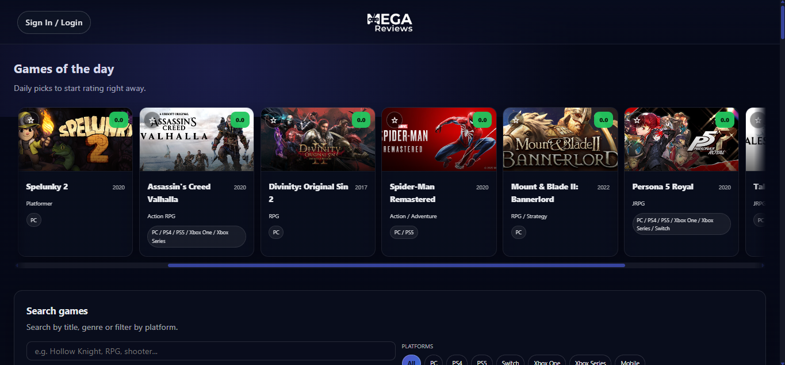
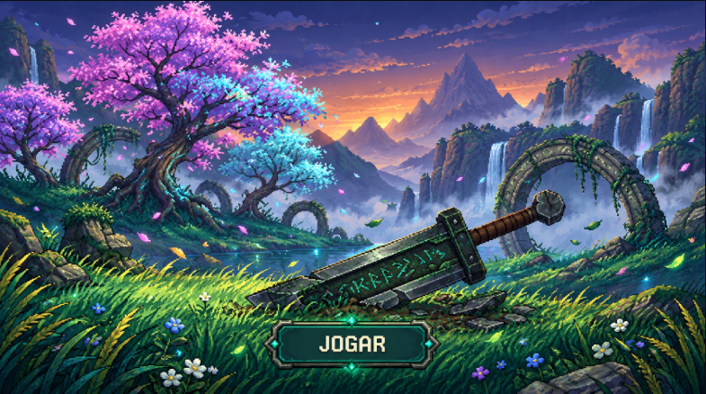

  

  
  
  

## 👋 About me

- 🎓 Master's student in Computer Engineering at the **University of Minho** (Braga, Portugal)
- 🏫 Bachelor's in Computer Engineering from the **University of Algarve**
- 🌐 Interested in **networks, cloud infrastructure and full-stack web development**
- 🎮 On the side, I build games in Godot
- 🗣️ Portuguese · Romanian · English · Spanish

## 🛠️ Tech stack

   
  

## 📌 Featured projects

<table>
  <tr>
    <td width="50%" valign="top">
      
      <h3><a href="https://github.com/karaasu13/game-reviews">MEGA Reviews</a></h3>
      Full-stack app to discover, rate and wishlist video games, with Steam metadata and image uploads.
        
      
      
      
      
    </td>
    <td width="50%" valign="top">
      
      <h3><a href="https://github.com/karaasu13/BoE-rmk">Blade of Exile</a></h3>
      2D hack 'n' slash platformer with a procedurally generated pixel-art pipeline. <i>(Image is concept art, not in-game footage.)</i>
        
      
      
      
    </td>
  </tr>
  <tr>
    <td colspan="2" valign="top">
      <h3><a href="https://github.com/karaasu13/picturas-27">PictuRAS</a></h3>
      University group project: a microservices web image editor with AI-powered tools, orchestrated with Docker Compose.
        
      
      
      
    </td>
  </tr>
</table>

## 📊 GitHub activity

  

  

  <picture>
    <source media="(prefers-color-scheme: dark)" srcset="https://raw.githubusercontent.com/karaasu13/karaasu13/output/github-snake-dark.svg" />
    
  </picture>

